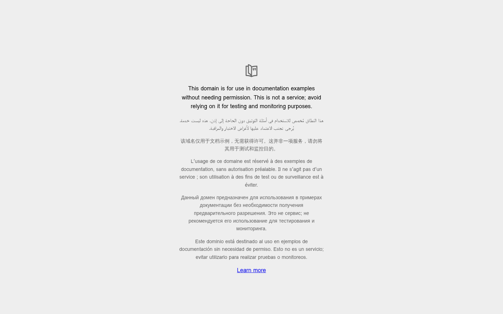

# Website Screenshot & PDF API: full-page screenshots, cookie banners removed, URL to PDF

Turn a list of URLs into clean screenshots (PNG, JPEG, WebP) or PDFs, with EU cookie banners accepted or hidden and
lazy-loaded content scrolled into view before a full-page capture. The
[Website Screenshot & PDF](https://apify.com/polderbyte/website-screenshot-pdf) Actor on Apify returns one row per URL
with a direct download link to the file, and you pay only for captures that worked.

This repository contains example code and documentation for calling that Actor from JavaScript, Python, `curl` or an
AI agent. The Actor itself runs on the Apify platform.

- Store page: https://apify.com/polderbyte/website-screenshot-pdf
- Actor ID for the API: `polderbyte/website-screenshot-pdf` (in URLs: `polderbyte~website-screenshot-pdf`)

## Who it's for

- **Website monitoring**: capture your own and competitors' pages on a schedule and compare (`sha256` changes when the
  image changes).
- **Archiving and compliance**: full-page PNG or PDF copies of pages, terms, prices or ads, with a timestamp and a
  SHA-256 hash.
- **Social previews and thumbnails**: 1200 x 630 JPEG or WebP images of any URL.
- **QA and visual testing**: desktop, laptop, tablet and phone screenshots, light and dark, without cookie banners.
- **Reports**: PDFs of dashboards, articles or landing pages; element crops of a chart or pricing table.
- **AI agents and LLM pipelines**: a clean, banner-free screenshot of a page for a vision model.

## Features

- **Cookie banners**: clicks "Accept all" on common consent platforms (OneTrust, Cookiebot, Didomi, Usercentrics,
  Quantcast, Sourcepoint, CookieYes, Complianz and about 20 more) and on buttons such as "Alles accepteren",
  "Akkoord", "Tout accepter" or "Alle akzeptieren", follows consent walls back to the page, and hides what is left.
- **Full pages**: scrolls first so lazy-loaded images and sections appear; pages that scroll inside a container are
  expanded; endless pages are cut at a maximum height you choose and flagged with `truncated: true`.
- **Devices**: Desktop (1440 x 900), Full HD, laptop, iPad Pro 11, iPhone 15, Pixel 8, or a custom viewport and pixel
  density.
- **Element crop** with any CSS selector, **dark mode** (the site's own dark theme or forced dark), optional **ad and
  tracker blocking**, **custom CSS**, browser **language**.
- **PDF**: A4, Letter, Legal, A3, A5, Tabloid; margins, landscape, backgrounds, screen or print stylesheet, scale.
- **Output**: one row per URL with a direct file link, size, page title, HTTP status, final URL, SHA-256 and the error
  if it failed.

## Sample output

A real run on 24 November 2026 with the input `{"urls": ["https://example.com"]}` (all other fields at their
defaults: PNG, desktop, viewport only) returned this row. The key-value store ID and the link signature in `fileUrl`
are replaced by placeholders; everything else is unchanged:

```json
{
  "url": "https://example.com/",
  "index": 0,
  "status": "ok",
  "error": null,
  "finalUrl": "https://example.com/",
  "httpStatus": 200,
  "title": "Example Domain",
  "format": "png",
  "device": "desktop",
  "fullPage": false,
  "selector": null,
  "width": 1440,
  "height": 900,
  "pages": null,
  "bytes": 74487,
  "truncated": false,
  "cookieBanner": null,
  "key": "example-com-a4d2dcb7.png",
  "fileUrl": "https://api.apify.com/v2/key-value-stores/<storeId>/records/example-com-a4d2dcb7.png?signature=<signature>",
  "contentType": "image/png",
  "sha256": "4a91a8feb4a54f0aefa119519c16f81c2212b55d0d0c4be266909aa0f063bfd5",
  "takenAt": "2026-11-24T17:58:45+00:00",
  "durationMs": 1526
}
```

And this is the file it produced ([`docs/example-com-desktop.png`](docs/example-com-desktop.png), same SHA-256):



A failed URL has `status: "error"` and the reason in `error`, for example `HTTP 404` or
`selector '#pricing' was not found on the page`, and is not charged.

## Quick start

You need an Apify account and an API token (Apify Console > Settings > API & Integrations). Put the token in an
environment variable, never in your code:

```bash
export APIFY_TOKEN=your_token        # PowerShell: $env:APIFY_TOKEN = "your_token"
```

### JavaScript / Node.js

```bash
npm install apify-client
```

```js
import { ApifyClient } from 'apify-client';

const client = new ApifyClient({ token: process.env.APIFY_TOKEN });

const run = await client.actor('polderbyte/website-screenshot-pdf').call({
    urls: ['https://www.example.com', 'https://en.wikipedia.org/wiki/Belgium'],
    fullPage: true,
});

const { items } = await client.dataset(run.defaultDatasetId).listItems();
for (const row of items) console.log(row.status, row.url, row.status === 'ok' ? row.fileUrl : row.error);
```

### Python

```bash
pip install apify-client
```

```python
import os
from apify_client import ApifyClient

client = ApifyClient(os.environ["APIFY_TOKEN"])

run = client.actor("polderbyte/website-screenshot-pdf").call(
    run_input={"urls": ["https://en.wikipedia.org/wiki/Belgium"], "format": "pdf", "pdfFormat": "A4"}
)

for row in client.dataset(run.default_dataset_id).iterate_items():
    print(row["status"], row["url"], row["fileUrl"] if row["status"] == "ok" else row["error"])
```

This uses `apify-client` 3.x for Python, where `call()` returns a `Run` object. With the older 1.x/2.x client, use
`run["defaultDatasetId"]`.

### curl

`run-sync-get-dataset-items` starts the run, waits for it to finish and returns the rows in one HTTP call:

```bash
curl -X POST "https://api.apify.com/v2/acts/polderbyte~website-screenshot-pdf/run-sync-get-dataset-items" \
  -H "Authorization: Bearer $APIFY_TOKEN" \
  -H "Content-Type: application/json" \
  -d '{"urls": ["https://example.com"]}'
```

Each row's `fileUrl` downloads the image or PDF. The synchronous endpoint waits up to 300 seconds; for big batches,
start the run asynchronously (`POST /v2/acts/polderbyte~website-screenshot-pdf/runs`) and add a webhook on *Run
succeeded*.

## More input examples

- Mobile screenshot in dark mode: `{"urls": ["https://github.com"], "device": "iphone-15", "darkMode": "site"}`
- Crop to one element: `{"urls": ["https://www.example.com"], "selector": "#pricing"}`
- URL to PDF: `{"urls": ["https://en.wikipedia.org/wiki/Belgium"], "format": "pdf", "pdfFormat": "A4", "pdfMargin": "10mm"}`
- Social preview image (1200 x 630): `{"urls": ["https://www.example.com"], "device": "custom", "viewportWidth": 1200, "viewportHeight": 630, "format": "jpeg"}`
- Retina screenshot: `{"urls": ["https://www.example.com"], "deviceScaleFactor": 2}`

## Examples in this repo

| File | What it does |
| --- | --- |
| [`examples/node/take-screenshot.mjs`](examples/node/take-screenshot.mjs) | Captures the URLs you pass, downloads each file to `output/` and saves the rows to `output/results.json` |
| [`examples/python/take_screenshot.py`](examples/python/take_screenshot.py) | The same in Python |

```bash
cd examples/node && npm install && node take-screenshot.mjs https://www.example.com
cd examples/python && pip install -r requirements.txt && python take_screenshot.py https://www.example.com
```

Both read `APIFY_TOKEN` from the environment, stop after 10 URLs (`maxItems`) and set a spending limit of $0.10 per
run.

## Input

| Field | Type | Default | Description |
| --- | --- | --- | --- |
| `urls` | array of strings | 2 sample URLs | Required. One URL per entry; a bare domain gets `https://`. Duplicates are removed; local and private addresses are not allowed. |
| `format` | string | `png` | `png`, `jpeg`, `webp` or `pdf`. |
| `device` | string | `desktop` | `desktop` (1440 x 900), `desktop-hd` (1920 x 1080), `laptop` (1366 x 768), `ipad`, `iphone-15`, `pixel-8` or `custom`. |
| `fullPage` | boolean | `false` | Capture the whole scrollable page. |
| `selector` | string | – | Crop to the first element matching this CSS selector. |
| `hideCookieBanners` | boolean | `true` | Accept or hide cookie banners and consent walls. |
| `darkMode` | string | `off` | `off`, `site` (prefers-color-scheme: dark) or `force` (Chromium's automatic dark mode). |
| `blockAds` | boolean | `false` | Block requests to 100+ ad, analytics and tracking hosts. |
| `viewportWidth`, `viewportHeight` | integer | `1440`, `900` | Viewport for the `custom` device. |
| `deviceScaleFactor` | integer | device default | Pixel density 1-3; 2 gives a retina image. |
| `waitUntil` | string | `load` | `load`, `domcontentloaded` or `networkidle`. |
| `delaySecs` | integer | `0` | Extra wait before the capture (0-30 s). |
| `scrollToBottom` | boolean | `true` | Scroll through the page first so lazy content loads (full page, element and PDF). |
| `maxHeight` | integer | `20000` | Cut full-page captures at this height in CSS pixels (1,000-50,000). |
| `customCss` | string | – | CSS injected before the capture, e.g. to hide a chat widget. |
| `locale` | string | `en-US` | Browser language, e.g. `nl-BE`, `fr-FR`. |
| `quality` | integer | `80` | JPEG/WebP quality 1-100. |
| `pdfFormat`, `pdfLandscape`, `pdfMargin`, `pdfPrintBackground`, `pdfMedia`, `pdfScalePercent` | | `A4`, `false`, `10mm`, `true`, `screen`, `100` | PDF options. |
| `maxConcurrency` | integer | `4` | Pages in parallel; lowered automatically to fit the run's memory. |
| `timeoutSecs` | integer | `90` | A URL that takes longer fails and is not charged. |
| `maxRetries` | integer | `1` | Retries for pages that fail to load. |
| `maxItems` | integer | `1000` | Capture at most this many URLs per run. |
| `keyValueStoreName` | string | – | Save files to a named key-value store (kept until you delete it) instead of the run's own store. |

## Pricing

Pay per successful capture: no subscription. Prices on 24 November 2026:

| Event | Price | When it's charged |
| --- | --- | --- |
| Screenshot | $0.003 | One viewport screenshot or element crop, any device and format |
| Full-page screenshot | $0.005 | One full-page screenshot, including the lazy-loading scroll pass |
| PDF | $0.006 | One PDF of a page, any number of pages |

Not charged: invalid URLs, pages that do not load, HTTP 4xx/5xx responses, pages blocked by bot protection or a
CAPTCHA, and a missing or hidden element when you capture a selector. Example: 1,000 full-page screenshots cost
1,000 × $0.005 = $5.00. Prices can change; the [Store page](https://apify.com/polderbyte/website-screenshot-pdf) shows
the current ones.

## Use it from an AI agent (Apify MCP server)

The [Apify MCP server](https://docs.apify.com/mcp) lets AI assistants such as Claude, Cursor or VS Code run Apify
Actors. To expose only this Actor as a tool, add it with the `tools` parameter:

```json
{
  "mcpServers": {
    "website-screenshot-pdf": {
      "url": "https://mcp.apify.com?tools=polderbyte/website-screenshot-pdf",
      "headers": {
        "Authorization": "Bearer <APIFY_TOKEN>"
      }
    }
  }
}
```

Leave out `headers` if your client supports OAuth: it then opens a browser to sign in to Apify. The Actor shows up as
the tool `polderbyte--website-screenshot-pdf`. With Claude Code:

```bash
claude mcp add --transport http website-screenshot-pdf "https://mcp.apify.com?tools=polderbyte/website-screenshot-pdf" \
  --header "Authorization: Bearer $APIFY_TOKEN"
```

For clients that only support local servers, run `npx -y @apify/actors-mcp-server --tools polderbyte/website-screenshot-pdf`
with `APIFY_TOKEN` set in its environment. Then ask, for example: *"Take a full-page screenshot of example.com on an
iPhone 15 in dark mode and give me the file link."*

## FAQ

**Does it solve CAPTCHAs or log in?** No. Pages behind a login or a CAPTCHA are reported as failed and not charged.
Some sites block all automated browsers; the Actor retries those once in a full desktop-grade browser.

**The page is cut off at 20,000 pixels.** That is the `maxHeight` safety limit for endless pages; the row has
`truncated: true`. Raise it up to 50,000. WebP images can be at most 16,383 pixels high.

**Can I get the mobile version of a site?** Yes. With `iphone-15`, `pixel-8` or `ipad` the browser reports a mobile
user agent, touch support and the device's screen size and pixel density.

**How long are the files kept?** Files in the run's own storage follow your Apify plan's data retention. Set
`keyValueStoreName` to keep them; keys then get a date-time prefix so repeated runs build a history.

**Are the file links public?** `fileUrl` points to the run's key-value store. Whether it opens without your API token
depends on your account's storage access setting; links for restricted stores are signed automatically.

**How much memory does a run need?** The default 2 GB captures 2 pages at a time (1 at a time for PDFs). More memory
captures more pages in parallel.

**Is this an official Apify repository?** No. It is example code from the Actor's developer.

## Links

- Actor on Apify Store: https://apify.com/polderbyte/website-screenshot-pdf
- Apify API, run synchronously and get dataset items: https://docs.apify.com/api/v2/actor-run-sync-get-dataset-items-post
- Apify JavaScript client: https://docs.apify.com/api/client/js/docs
- Apify Python client: https://docs.apify.com/api/client/python/docs
- Apify MCP server: https://docs.apify.com/mcp

## License

The example code in this repository is released under the [MIT License](LICENSE). Use of the Actor on Apify is billed
by Apify under its terms.
